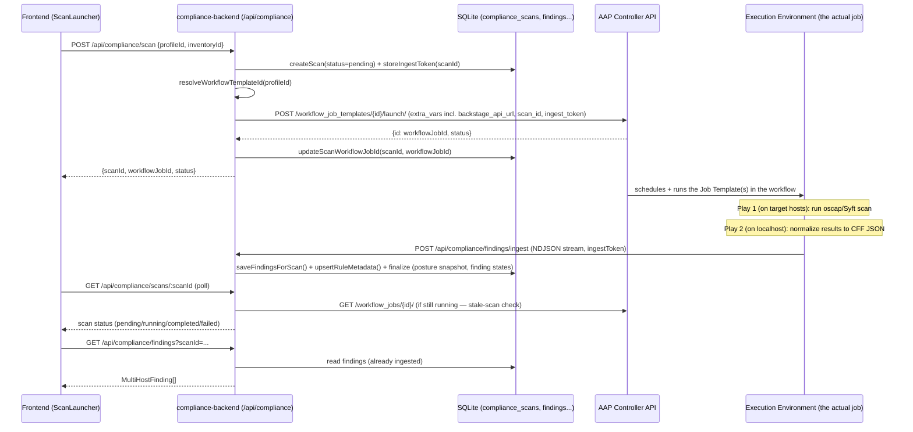

# How the AAP Compliance Dashboard Works (Mock vs Live)

This doc explains, end-to-end, how a compliance scan actually runs when the
plugin is **not** in mock mode — i.e. is it really hitting AAP Controller
endpoints, and what happens between "click Scan" and "see Findings".

Scope: `backstage-app/plugins/compliance` (frontend) +
`backstage-app/plugins/compliance-backend` (backend) + the Ansible content
under `profiles/*`.

---

## 1. The mock/live toggle

Everything hinges on one config key:

```yaml
# app-config.yaml
ansible:
  compliance:
    dataSource: mock   # or: live
```

This is read **once**, in the backend, by `ComplianceService`'s constructor:

```10:18:backstage-app/plugins/compliance-backend/src/service/ComplianceService.ts
const rawSource = config.getOptionalString('ansible.compliance.dataSource') ?? 'mock';
this.dataSource = rawSource === 'live' ? 'live' : 'mock';
```

Important architectural point: **the frontend never knows or decides
mock vs live.** The frontend (`ComplianceBackendClient.ts`) always just calls
`/api/compliance/*` REST endpoints on the backend. The backend's
`ComplianceService` is the only place with an `if (dataSource === 'mock')`
branch. Every public method on the service (`getProfiles`, `launchScan`,
`getFindings`, `getInventories`, ...) checks `this.dataSource` and either:

- **mock** → returns canned data from `MockDataProvider` (or DB rows seeded
  once at boot by `MockDataSeeder`), **no network call**, or
- **live** → calls out to AAP Controller via `ControllerClient` (a thin
  `undici`-based HTTP client), which **does** hit real endpoints.

`./bin/start.sh mock|live` just flips this one YAML value (via `sed`) before
starting the backend. Everything downstream is identical code either way.

---

## 2. In live mode: yes, it genuinely hits AAP Controller REST endpoints

`ControllerClient.ts` is a straightforward wrapper around AAP's Controller
API (`/api/controller/v2/...`), auth'd with a Bearer token, using `undici`
`fetch` + an `Agent` (for `checkSSL: false` support against self-signed lab
certs). Endpoints it calls:

| Purpose | Method / Endpoint |
|---|---|
| List workflow job templates | `GET /api/controller/v2/workflow_job_templates/` |
| Launch a workflow (scan) | `POST /api/controller/v2/workflow_job_templates/{id}/launch/` |
| List job templates | `GET /api/controller/v2/job_templates/` |
| Launch a job template (remediation) | `POST /api/controller/v2/job_templates/{id}/launch/` |
| Workflow job status (polling) | `GET /api/controller/v2/workflow_jobs/{id}/` |
| Workflow nodes (find child job) | `GET /api/controller/v2/workflow_jobs/{id}/workflow_nodes/` |
| Job status / stdout / events (fallback parsing, error details) | `GET /api/controller/v2/jobs/{id}/...` |
| Inventories / hosts / facts | `GET /api/controller/v2/inventories/...`, `/hosts/{id}/ansible_facts/` |
| Execution environments | `GET /api/controller/v2/execution_environments/` |

Auth: every request carries `Authorization: Bearer <token>`. The token is
either the **per-user AAP OAuth2 token** forwarded from the frontend (header
`x-aap-token`, when running inside Ansible Portal/RHDH) or, if absent, the
**service token** from `ansible.rhaap.token` in `app-config.yaml`. This
means in production, AAP's own RBAC decides what inventories/job templates a
given user can see/launch — Backstage doesn't re-implement that.

So: **yes**, live mode is a real integration, not a simulation — it's
launching real Job Templates / Workflow Job Templates in AAP Controller and
polling their status.

---

## 3. End-to-end flow of a live scan



### Step-by-step

**1. User clicks "Run Scan"** in `ScanLauncher` (frontend), picking a
   compliance profile + an AAP inventory.

**2. Frontend → Backend:** `POST /api/compliance/scan`
   (`registerScanRoutes` in `routes/scans.ts`), body:
   `{ profileId, inventoryId, limit?, workflowTemplateId?, scanType? }`.

**3. Backend creates the scan bookkeeping first, before touching AAP:**
   - Generates a random `ingestToken` (`crypto.randomUUID()`).
   - `database.createScan({ status: 'pending', workflowJobId: null, ... })`.
   - `database.storeIngestToken(scanId, ingestToken)` — this token is the
     *only* thing that will let the playbook POST findings back in later
     (see §8, security model).

**4. `ComplianceService.launchScan()` resolves which AAP template to run:**
   resolution order is (a) explicit `workflowTemplateId` in the request, (b)
   the profile's registered template in the DB (`profiles` table —
   "Settings" tab maps a compliance profile to a specific assessment JT), (c)
   a name-based search on the Controller (`listWorkflowJobTemplates('compliance')`)
   as a last resort.

**5. Backend builds `extra_vars` and calls AAP Controller:**
   ```ts
   const extraVars = {
     compliance_profile: request.profileId,
     inventory_id: request.inventoryId,
     backstage_api_url: config.get('backend.baseUrl'),   // e.g. http://localhost:7007
     scan_id: scanId,
     ingest_token: ingestToken,
     _gather_facts: request.gatherFacts ?? false,
     pah_registry, pah_username, pah_password,            // EE image pull creds
   };
   ControllerClient.launchWorkflow(templateId, extraVars, userToken, limit, undefined, inventoryId);
   // → POST {rhaap.baseUrl}/api/controller/v2/workflow_job_templates/{id}/launch/
   ```
   If the configured template turns out to be a plain Job Template instead of
   a Workflow Job Template, it transparently retries via
   `launchJobTemplate()` (404 fallback).

**6. Backend stores the returned `workflowJobId` on the scan row** and
   returns `{ scanId, workflowJobId, status }` to the frontend immediately —
   it does **not** block waiting for the scan to finish.

**7. AAP runs the actual job.** This is where the Ansible content under
   `profiles/<profile>/.../playbooks/run_oscap.yml` (or `run_scan.yml` for
   supply-chain) executes, inside the profile's Execution Environment:
   - **Play 1** (on the target hosts): installs/uses `oscap`, copies the SCAP
     datastream from the EE, runs `oscap xccdf eval`, fetches the raw XCCDF
     XML results back to the execution node, cleans up the target.
   - **Play 2** (on `localhost`, same container): loops over every fetched
     host's XML and calls the collection's `normalize_xccdf` module, which
     parses XCCDF → Common Findings Format (CFF) JSON, merges in
     `aap_impact` classification + `fix_text` (CaC remediation YAML) from
     the collection's `rules/*.yml` metadata, and — because
     `backstage_api_url` was passed — **composes an NDJSON post body file**
     per host (`compose_post_body: true`, ADR-033).
   - (Supply-chain profile instead runs Syft on targets to build an SBOM,
     fetches it back, then runs Grype on localhost against the SBOM and
     normalizes via `normalize_cyclonedx.py` — same POST pattern after.)

**8. The playbook POSTs findings directly back to Backstage** — this is the
   actual network call from inside the AAP job:
   ```yaml
   - name: Stream NDJSON findings per-host to Backstage compliance API
     ansible.builtin.uri:
       url: "{{ backstage_api_url }}/api/compliance/findings/ingest"
       method: POST
       src: "{{ item.path }}"              # streams the file, never loads it into Jinja2
       headers:
         Content-Type: application/x-ndjson
       status_code: [201]
   ```
   This is the "Direct POST" pattern (ADR-007/ADR-033/ADR-034): the EE
   streams one NDJSON file per host straight to the Backstage backend, with
   zero findings data ever materialized as an Ansible variable (important —
   some profiles produce 4000+ findings per host, which would blow out
   Controller's event payload limits if sent as job output instead).

**9. Backend's ingest endpoint persists everything:**
   `POST /api/compliance/findings/ingest` (`routes/findings.ts`,
   `handleNdjsonIngest`):
   - First NDJSON line is a *preamble* (`{_meta: true, scanId, ingestToken, host, ...}`).
     Validates `scan` exists and `ingestToken` matches the one stored in
     step 3 — **this is the entire auth model for this endpoint**, since the
     playbook has no Backstage user session (see §8).
   - Every subsequent line is one finding; batched 500-at-a-time into
     `database.saveFindingsForScan()`.
   - Rule metadata (title, severity, fix_text, aap_impact) is upserted
     separately into a `rule_metadata` table, deduplicated across scans.
   - On the last line (`finalize: true`, i.e. `ansible_loop.last` for the
     final host in the playbook's loop), `finalizeIngest()` runs: marks the
     scan `completed`, counts distinct rules, computes a posture snapshot
     (pass/fail %), and computes finding **state** transitions (`new` /
     `active` / `fixed` / `resurfaced`) by diffing against the previous scan
     for that profile+inventory.

**10. Frontend polls for status/results** — two independent polling loops:
   - `GET /api/compliance/scans/:scanId` — while rendering the "scan in
     progress" UI. If `dataSource === 'live'` and the scan is still
     `pending`/`running`, the `/scans` list endpoint opportunistically
     double-checks against AAP (`getWorkflowJobStatus` → falls back to
     `getJobStatus` if it's not actually a workflow) and flips the DB status
     to `completed`/`failed` once AAP reports a terminal state — this is a
     safety net in case the Direct POST from the EE never arrived (job
     crashed before Play 2, network blip, etc.).
   - `GET /api/compliance/findings?scanId=...` — reads straight from SQLite;
     by the time the UI is polling this, the data has normally already
     arrived via the Direct POST in step 9.

---

## 4. Provisioning: where do the Job Templates actually come from?

**The Backstage app never creates Job Templates or Workflow Job Templates on
AAP.** Step 4 above only *resolves and launches* a template that must
already exist. Provisioning is a separate, one-time, out-of-band step.

### `install.yml` — one per profile

```
profiles/rhel9-stig/install.yml
profiles/rhel9-cis-l1/install.yml
profiles/rhel9-cis-l2/install.yml
profiles/supply-chain/install.yml
```

Each is a standalone playbook (not run via the Backstage backend, not run
via any job template) that an admin runs directly against AAP Controller's
REST API, once per AAP environment, to provision that profile:

```bash
cd profiles/rhel9-stig
ansible-playbook install.yml -e aap_host=https://your-aap-controller -e aap_token=<token>
# or: export AAP_HOST=... AAP_API_TOKEN=... && ansible-playbook install.yml
```

What it does (`rhel9-stig/install.yml` as the concrete example):

```49:91:profiles/rhel9-stig/install.yml
- name: Create assessment job template
  ansible.builtin.uri:
    url: "{{ aap_host }}/api/controller/v2/job_templates/"
    method: POST
    headers:
      Authorization: "Bearer {{ aap_token }}"
      Content-Type: "application/json"
    body_format: json
    body:
      name: "{{ profile.scan_jt_name }}"              # "compliance-scan-stig-rhel9"
      organization: "{{ org_name }}"
      project: "{{ project_name }}"
      playbook: "{{ profile.scan_playbook }}"          # .../run_oscap.yml
      inventory: "{{ inventory_name }}"
      become_enabled: true
      ask_variables_on_launch: true
      ask_inventory_on_launch: true
      use_fact_cache: true
      extra_vars: "{{ {...} | to_json }}"              # profile_slug, framework, oscap_xccdf_profile, etc.
    validate_certs: false
    status_code: [200, 201]
  register: _scan_jt

- name: Create remediation job template
  ansible.builtin.uri:
    url: "{{ aap_host }}/api/controller/v2/job_templates/"
    method: POST
    ...
    body:
      name: "{{ profile.remediate_jt_name }}"          # "compliance-remediate-stig-rhel9"
      playbook: "{{ profile.remediate_playbook }}"     # .../remediate.yml
      ask_variables_on_launch: true
      ask_inventory_on_launch: true
      ask_tags_on_launch: true
      ask_limit_on_launch: true
  register: _remediate_jt
```

It `POST`s to the exact same `api/controller/v2/job_templates/` endpoint the
backend later reads from — it's just a different caller, run manually,
once. At the end it prints a `debug` summary with the resulting JT IDs:

```
=== DISA STIG RHEL 9 Profile Installed ===
Assessment JT: compliance-scan-stig-rhel9 (id=42)
Remediation JT: compliance-remediate-stig-rhel9 (id=43)
```

Prerequisites it assumes already exist in AAP (it does **not** create
these): a Project pointing at this Git repo (so AAP can sync the playbook
content), an Execution Environment with the right tooling baked in
(`openscap-scanner` + `scap-security-guide` for XCCDF profiles, Syft+Grype
for supply-chain), a target Inventory, and a Machine credential with SSH
access to the targets.

Each profile also ships a matching `uninstall.yml` next to `install.yml` to
tear the JTs back down.

### Registration — the missing manual step

`install.yml` only creates the JTs and prints their IDs — it does **not**
register them with the Backstage plugin's own database. Someone (an admin)
has to take the printed JT ID and enter it in the plugin's **Settings tab**,
which maps `profileId → workflowTemplateId` / `remediateJtId` in the
`profiles` table. That registered mapping is resolution option (b) in step 4
above — without it, every scan/remediation falls through to the
name-based-search fallback (option c), which is fragile in multi-profile
deployments (it just grabs the first template whose name matches
`compliance`/`compliance-remediate`).

So the full provisioning chain, in order, is:

1. EE image built + pushed (PAH), Project/Inventory/Credential created in AAP (manual/separate).
2. `install.yml` run once → creates the Assessment JT + Remediate JT on Controller.
3. Admin copies the JT ID(s) into the Settings tab → persisted to the `profiles` table.
4. Only now will `POST /api/compliance/scan` reliably resolve and launch the *correct* template every time.

---

## 5. Handling multiple Linux distributions (platform validation)

Not every profile can run on every host — a RHEL9-specific STIG/CIS scan
makes no sense on a Debian box. This is handled by a `platform_spec` that
each profile declares, checked against real host facts **before** a scan
launches.

### Where `platform_spec` comes from

Declared per-profile in that profile's own metadata file and copied into
the Backstage `profiles` table at registration time (ADR-011,
`platform_spec` JSON column — see
`database/migrations/20260528_006_platform_spec.ts`):

```12:31:profiles/rhel9-stig/ansible_collections/security/compliance_rhel9_stig/meta/compliance-profile.yml
profile:
  platform: "RHEL 9"
  scanner: "openscap"
  ...
  platform_spec:
    os_family: ["RedHat"]
    os_version: ["9"]
```

```8:16:profiles/supply-chain/ansible_collections/security/compliance_supply_chain/meta/compliance-profile.yml
profile:
  platform: "Linux (multi-distro)"
  scanner: "syft-grype"
  ...
  platform_spec:
    os_family: ["RedHat", "Debian", "Suse", "Alpine"]
```

So the two scanner architectures differ sharply here:
- **XCCDF profiles (STIG, CIS L1/L2)** are pinned to `RedHat` + major
  version `9` — they ship a RHEL9-specific SCAP datastream
  (`ssg-rhel9-ds.xml`), so running them against anything else would just
  fail the `oscap xccdf eval` step or produce meaningless results.
- **The supply-chain profile (Syft+Grype)** is genuinely multi-distro —
  Syft/Grype work against package manifests regardless of OS family, so its
  `os_family` list covers `RedHat`, `Debian`, `Suse`, and `Alpine`, with no
  `os_version` restriction at all.

An optional `scanner_validates: true` flag on the spec means "the scanner
itself checks compatibility at runtime, skip Backstage-side validation
entirely" — in that case `validatePlatform()` short-circuits and reports
every host as matched.

### Validation flow: `POST /api/compliance/scan/validate`

Before actually launching a scan, the Scan Launcher UI calls
`POST /api/compliance/scan/validate` with `{ profileId, inventoryId }`
(`routes/scans.ts`). This:

1. Loads the profile's `platformSpec` from the DB. If it's `null` or has
   `scanner_validates: true`, immediately returns `valid: true` for every
   host — no AAP call needed.
2. Otherwise calls `service.getInventoryHostFacts(inventoryId, userToken)`,
   which (in live mode) hits AAP:
   ```ts
   GET /api/controller/v2/inventories/{inventoryId}/hosts/?page_size=200
   // then, per host:
   GET /api/controller/v2/hosts/{hostId}/ansible_facts/
   ```
   pulling `ansible_os_family`, `ansible_distribution_major_version`, and
   `device_type` for every host in the target inventory — these are AAP's
   cached Ansible facts (`use_fact_cache: true` is set on the assessment JTs
   in `install.yml`), so this doesn't trigger a live fact-gathering run.
3. `PlatformValidator.validatePlatform(spec, hostFacts)` checks each host's
   `os_family` / `os_version` / `device_type` against the spec's allow-lists
   and buckets hosts into `matchedHosts` vs `mismatchedHosts` (with a
   human-readable reason per mismatch, e.g. `"OS version '8' not in [9]"`).
4. The UI surfaces this as a warning/block before letting the user proceed
   with hosts that don't match the profile's declared platform.

**Graceful degradation**: if a host simply has no cached facts at all
(`factsAvailable: false` for that host — e.g. it's never had a job run
against it, or fact caching is disabled), it's treated as a **match by
default** rather than blocking the scan — the validator optimistically lets
it through and relies on the actual scan step to fail/no-op if it's
genuinely incompatible. The overall `factsAvailable` flag tells the UI
whether it got *any* real signal at all, so it can show "platform check
unavailable" rather than a false "all good".

### Mock mode

`getInventoryHostFacts()` returns `[]` immediately in mock mode (no AAP
call), so platform validation in the mock dev shell always has no facts to
check against and effectively no-ops.

---

## 6. Fallback path: fetching results from Controller job events

If the Direct POST never happened (older scans, or a playbook that didn't
set `backstage_api_url`), the backend can reconstruct findings by reading
the job's events straight out of Controller — `fetchAndParseResults()` in
`ComplianceService.ts`:

1. `GET /workflow_jobs/{id}/workflow_nodes/` → find the child job whose
   identifier/name looks like `run-oscap` / `normaliz` / `evaluat`.
2. `GET /jobs/{normalizeJobId}/job_events/?event=runner_on_ok` (+
   `runner_item_on_ok`, for per-host loop iterations) — paginated, capped at
   `maxPages` to avoid pulling 17k+ events for huge remediation jobs.
3. `FindingsParser.parseJobEvents()` extracts the `res.findings` /
   `ansible_facts.findings` payload Ansible attached to each `debug`/module
   result and maps it into `StoredFinding` rows.
4. Persists to DB the same way the ingest endpoint does, plus a best-effort
   rule-metadata upsert if the event payload has the "full" fields
   (`fix_text`/`description`) rather than the slim format.

This is also used for `POST /api/compliance/scans/:scanId/backfill` (manual
re-ingest for old scans) and for `fetchScanErrorDetails()` /
`fetchRemediationErrorDetails()`, which walk workflow nodes →
`result_traceback` → failure events → job stdout (in that priority order) to
surface a human-readable error in the UI when a scan/remediation job fails.

---

## 7. Remediation launches (same pattern, different grouping)

`POST /api/compliance/remediate` → `ComplianceService.launchRemediation()`:

1. Resolves the **Remediate Job Template** ID (profile registry, or a
   name-search fallback for `compliance-remediate`).
2. `RemediationPlanBuilder.buildRemediationPlan()` groups the user's
   selected rules by **which hosts actually failed them** in the latest
   scan's findings, so each AAP job launch only targets the hosts/rules that
   need it (`job_tags` = rule tags, `limit` = host group).
3. One `POST /job_templates/{remediateJtId}/launch/` per group — these JTs
   run the CaC (Compliance-as-Code) Ansible remediation playbook from
   `scap-security-guide`, scoped by `job_tags`.
4. Returns the first job's ID for the frontend to track (others run in
   parallel); error details use the same traceback→events→stdout fallback
   chain as scans.

---

## 8. Auth model summary (who can call what)

Two independent layers:

- **Backstage layer** (`plugin.ts`): gates *mutating* endpoints (`/scan`,
  `/remediate`, `/remediation-profiles`, ...) behind
  `catalogEntityCreatePermission` via `httpAuth`/`permissions`, **except**
  in `ansible.compliance.authMode: development` (the local `./bin/start.sh
  mock` dev shell), where every route is marked
  `allow: 'unauthenticated'` so guest auth "just works".
  `/findings/ingest` is **always** unauthenticated at this layer in both
  modes — see below.
- **AAP layer**: every Controller API call carries either the logged-in
  user's AAP OAuth2 token (`x-aap-token` header, forwarded end-to-end from
  the frontend's `aapAuthApi`) or the service account token from
  `ansible.rhaap.token`. AAP's own RBAC governs what inventories/templates
  that identity can touch.
- **Ingest security** (ADR-010): `/findings/ingest` can't require a
  Backstage user session because the caller is an Ansible playbook running
  inside an EE, not a logged-in person. Instead, each scan gets a random
  `ingestToken` at creation time, stored server-side, and passed to the
  playbook as an extra_var; the ingest endpoint rejects any POST whose
  `ingestToken` doesn't match the one on record for that `scanId`. It's also
  rate-limited (500 req/min) and size-capped (per-line 100KB, 500k findings
  max per stream).

---

## 9. Quick reference: config keys that drive this

```yaml
ansible:
  compliance:
    enabled: true          # Plugin Factory kill-switch (frontend+backend)
    dataSource: mock|live  # the toggle described in §1 (backend-only)
    authMode: development|production
    retentionDays: 90      # findings older than this get purged at boot
  rhaap:
    baseUrl: ${AAP_HOST}       # required when dataSource=live
    token: ${AAP_API_TOKEN}    # service-account fallback token
    checkSSL: false            # lab certs are usually self-signed
backend:
  baseUrl: http://localhost:7007   # sent to the playbook as backstage_api_url
```

`./bin/start.sh live .env.netrunner` is the convenience wrapper that sets
`dataSource: live` and sources an env file with `AAP_HOST`/`AAP_API_TOKEN`
before starting.

---

## 10. Reconciliation: what exists today vs. what's actually needed

"Reconciliation" appears in the roadmap as a future capability (identify and
reflect scans/remediations launched outside the Compliance Experience — via
manual Controller launches, EDA, native workflows, or Automation
Orchestrator). It's worth being precise about what the word already means in
the *current* code, because it's a narrower thing than that.

### What exists today: lazy, pull-based status-sync for self-initiated work

Two near-identical mechanisms, both triggered opportunistically on normal
page-load traffic (no webhook, no polling daemon, no EDA listener):

**Scan status reconciliation** — `routes/scans.ts`, inside `GET /scans`:

```22:57:backstage-app/plugins/compliance-backend/src/routes/scans.ts
if (service.getDataSource() === 'live') {
  const staleScans = scans.filter(
    s => (s.status === 'running' || s.status === 'pending') && s.workflowJobId
      && now - (state.staleScanThrottle.get(s.id) ?? 0) > state.STALE_CHECK_INTERVAL_MS,
  );
  await Promise.all(staleScans.map(async scan => {
    let status = await service.getWorkflowJobStatus(scan.workflowJobId!, userToken); // falls back to getJobStatus
    // → flips DB status pending→running, or to completed/failed on terminal state
  }));
}
```

**Remediation execution reconciliation** — `routes/remediation.ts`, inside
`GET /remediation-profiles`:

```340:366:backstage-app/plugins/compliance-backend/src/routes/remediation.ts
const running = await database.getStaleRunningExecutions(0);
for (const exec of running) {
  if (!exec.primaryJobId) continue;
  const job = await service.getJobStatus(exec.primaryJobId, userToken);
  if (['running','pending','waiting','new'].includes(job.status)) continue;
  const resolvedStatus = job.status === 'successful' ? 'succeeded' : 'failed';
  await database.updateExecutionStatus(exec.id, { status: resolvedStatus, completedAt: job.finished, ... });
}
```

Both follow the same shape:
- Throttled per-row via `staleScanThrottle` / `executionReconcileThrottle`
  maps (`STALE_CHECK_INTERVAL_MS` = 30s), so a busy page doesn't hammer
  Controller on every render.
- **Only operate on rows that already exist in our DB** —
  `scan.workflowJobId` / `exec.primaryJobId` is only populated because *we*
  stored it when `launchScan()` / `launchRemediation()` ran. There's no
  independent discovery step; it's purely "catch up the status of things we
  already know about," for the case where the Direct POST from the EE never
  arrived (job crashed before Play 2, network blip, etc.) — see §3 step 10.

### What's conspicuously absent: discovery of jobs we didn't launch

`routes/controller.ts` is the only AAP-facing "browse" surface, and every
endpoint on it takes an explicit `jobId`/`templateId` as a path param
(`/job-status/:jobId`, `/workflow-nodes/:jobId`, `/job-events/:jobId`, ...).
**There is no endpoint anywhere that lists/searches Controller jobs by tag,
name, or time window to find jobs we don't already have a DB row for.** So:

- A job launched by hand on Controller, by a scheduled Controller job, by
  EDA, or by Automation Orchestrator → **invisible** to the Compliance
  Experience. No `compliance_scans` row ever gets created for it, because
  the only code path that creates that row is `POST /api/compliance/scan`'s
  handler (`routes/scans.ts`, `database.createScan()`).
- Even if you knew the job ID and wanted to manually associate it after the
  fact, there's no "attach this existing Controller job to a scan record"
  endpoint. `createScan()` is only ever called from the scan-launch flow,
  always paired with minting a fresh `ingestToken` (§8) at the same moment.

### The gap, concretely

Building real Phase-3 reconciliation needs at least:

1. **Discovery** — a Controller job-listing/search call (by JT name pattern
   or a compliance-specific job tag/label) to find jobs that match a
   registered profile's assessment/remediate JT but have no corresponding
   local row.
2. **Retroactive record creation** — a new path to create a
   `compliance_scans` / `compliance_remediation_executions` row for a job
   that already exists on Controller, inferring `profileId` (from the JT →
   profile registry mapping) and `inventoryId` (from the job's inventory
   field) instead of from a user's launch request.
3. **An ingest security story for findings with no pre-minted token** — the
   entire `/findings/ingest` auth model (§8, ADR-010) assumes `ingestToken`
   was generated and stored *before* the job was launched, because
   `createScan()` always runs first today. A reconciled job was already
   running (or already finished) before the Compliance Experience ever knew
   about it, so there's no symmetric point to mint and hand it a token —
   this likely needs either a different ingest path for reconciled jobs
   (e.g. pull results via the job-events fallback in §6 instead of waiting
   for Direct POST) or a profile-level shared token issued at JT-registration
   time rather than per-scan.
